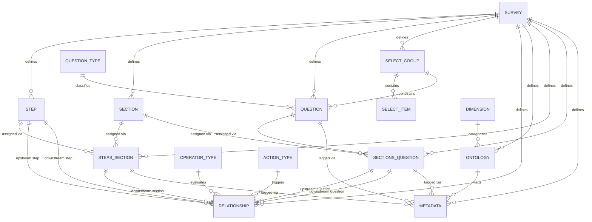

# Entity Model

Source: `docs/requirements.md`, `docs/scd-contract.md`, and the shared
`survey` schema (`Survey/src/main/resources/db/migration/V001__Create_Survey_Schema.sql`,
the greenfield track with Kimball Type 2 SCD already baked in) as it lives in
**Author's own working database**. Entity and attribute names below are the
actual `survey.*` table/column names, since Author's JPA/Panache entities map
directly onto them — this document describes the existing schema, it does not
propose a new one.

> **Revision note (2026-09-17):** in Author every element has exactly one row —
> `version = 0`, epoch `effective_from`, sentinel `effective_to` while current or
> a real close instant once removed. Version rows are created only by Admin's
> update service at deployed sites. Every table also carries a **UUID element
> key** (`survey_key`, `question_key`, …) that is the cross-deployment identity;
> earlier drafts of this model omitted those columns. The `is_draft` column is
> being dropped (Survey `V015`) and is not mapped by Author.

Terminology, per `docs/scd-contract.md`: `id` is always the surrogate
primary key of one physical version row; `{entity}_id` is the durable key
shared by every version of that logical entity; `version` increments on
publish; "current" means `effective_to = '9999-12-31 23:59:59+00'` (there is
**no** `is_current` flag); an earlier `effective_to` marks a removed (retired) row. A
`_version` column that is a `CHECK`-pinned `0` (e.g. `select_group_version`)
is an FK-existence sentinel, not a real version pin — it is called out per
attribute below, not modeled as a live reference. `{entity}_key` is the element
key: minted once, never regenerated, preserved verbatim by import/export.

## Entity Relationship Diagram

### SURVEY

A single survey definition; the container for a survey's structure. Type 1 — in-place edits, never versioned.

| Attribute            | Description                                                                  | Data Type | Length/Precision | Validation Rules      |
|-----------------------|-------------------------------------------------------------------------------|-----------|-------------------|------------------------|
| id                    | Unique identifier (per database)                                              | Integer   | 10                | Primary Key, Sequence  |
| survey_key            | Element key: cross-deployment identity of this authored survey; minted once, never changes | UUID | -            | Not Null, Unique       |
| name                  | Internal survey name                                                          | String    | 255               | Not Null, Unique       |
| display_order         | Order surveys are listed in                                                   | Integer   | 10                | Not Null, Unique       |
| title                 | Respondent-facing survey title                                                | String    | 255               | Not Null               |
| description           | Survey purpose/description                                                    | String    | 2000              | Optional               |
| initial_display_key   | Display key of the first step/section/question shown to a respondent          | String    | 255               | Optional               |
| post_survey_url       | URL to redirect to after survey completion                                    | String    | 255               | Optional               |
| published_by          | Identity of the author who last exported this survey (stamped at export; carried in the file) | String | Unlimited (text) | Optional        |
| published_comment     | Release note supplied at the last export                                      | String    | Unlimited (text)  | Optional               |

### QUESTION_TYPE

A supported kind of respondent input (e.g. TEXT, RADIO, CHECKBOX_GROUP); a fixed, platform-wide vocabulary, not survey-scoped.

| Attribute   | Description                                        | Data Type | Length/Precision | Validation Rules      |
|-------------|-----------------------------------------------------|-----------|-------------------|------------------------|
| id          | Unique identifier                                   | Integer   | 10                | Primary Key, Sequence  |
| name        | Question type name                                  | String    | 255               | Not Null, Unique       |
| data_type   | Underlying data type the question type stores       | String    | 255               | Optional               |
| description | Human-readable description of the question type     | String    | 255               | Optional               |

### OPERATOR_TYPE

A comparison operator usable in a relationship's condition (BOOLEAN, GREATER_THAN, EQUAL, NOT_EQUAL, FIELD_EXIST, CONTAINS); a fixed, platform-wide vocabulary.

| Attribute   | Description                                  | Data Type | Length/Precision | Validation Rules      |
|-------------|------------------------------------------------|-----------|-------------------|------------------------|
| id          | Unique identifier                             | Integer   | 10                | Primary Key, Sequence  |
| name        | Operator name                                 | String    | 255               | Not Null, Unique       |
| description | Human-readable description of the operator     | String    | 255               | Optional               |
| symbol      | Display symbol for the operator (e.g. =, >)    | String    | 10                | Optional               |

### ACTION_TYPE

An effect a relationship can trigger when its condition is met (SHOW, REPEAT, TEXT); a fixed, platform-wide vocabulary.

| Attribute   | Description                              | Data Type | Length/Precision | Validation Rules      |
|-------------|--------------------------------------------|-----------|-------------------|------------------------|
| id          | Unique identifier                         | Integer   | 10                | Primary Key, Sequence  |
| name        | Action name                               | String    | 255               | Not Null, Unique       |
| description | Human-readable description of the action   | String    | 255               | Optional               |

### SELECT_GROUP

A named collection of selectable options for choice-based questions. Type 2 SCD structural element (durable key: `select_group_id`).

| Attribute          | Description                                                                              | Data Type | Length/Precision | Validation Rules                                     |
|--------------------|--------------------------------------------------------------------------------------------|-----------|-------------------|--------------------------------------------------------|
| id                 | Surrogate primary key of this specific version row                                        | Integer   | 10                | Primary Key, Sequence                                  |
| survey_id          | Survey this select group belongs to                                                       | Integer   | 10                | Not Null, Foreign Key (surveys.id)                     |
| name               | Select group name                                                                          | String    | 255               | Not Null, Unique among current rows per survey         |
| description        | Select group description                                                                  | String    | 255               | Optional                                               |
| data_type          | Data type of the coded values                                                              | String    | 50                | Not Null, Default: Text                                |
| select_group_id    | Durable key shared by every version of this select group                                  | Integer   | 10                | Not Null                                               |
| select_group_key | Element key: cross-deployment identity, minted once, copied to every version, never regenerated | UUID | - | Not Null, Unique with version |
| version            | Version number; always 0 in Author, incremented by Admin's update service at deployed sites | Integer   | 10                | Not Null, Default: 0                                    |
| effective_from     | Start of validity; epoch in Author (Admin stamps a real instant when it versions at a site) | DateTime  | -                 | Not Null, Default: 1970-01-01T00:00:00Z                 |
| effective_to       | `9999-12-31T23:59:59Z` = current; an earlier instant = removed (retired) in Author, closed at a site | DateTime  | -                 | Not Null, Default: 9999-12-31T23:59:59Z                 |
| published_by       | Carried from the applied file; not set by Author on structural rows                      | String    | Unlimited (text)  | Optional                                               |
| published_comment  | Carried from the applied file; not set by Author on structural rows                      | String    | Unlimited (text)  | Optional                                               |

**Constraints:** At most one current row (`effective_to = 9999-12-31T23:59:59Z`) may exist per `select_group_id`; `(select_group_key, version)` is unique. `(survey_id, name)` is unique only among current rows — a retired version and its successor may legitimately share the old name.

### SELECT_ITEM

One selectable option (coded value + display text) belonging to a select group. Type 2 SCD structural element (durable key: `select_item_id`).

| Attribute              | Description                                                                                     | Data Type | Length/Precision | Validation Rules                                                   |
|------------------------|----------------------------------------------------------------------------------------------------|-----------|-------------------|----------------------------------------------------------------------|
| id                     | Surrogate primary key of this specific version row                                                | Integer   | 10                | Primary Key, Sequence                                                |
| survey_id              | Survey this select item belongs to                                                                | Integer   | 10                | Not Null, Foreign Key (surveys.id)                                   |
| select_group_id        | Durable key of the select group this item belongs to                                              | Integer   | 10                | Not Null, Foreign Key (select_groups.select_group_id, version)       |
| select_group_version   | FK-existence sentinel, always 0 — the select group's actual current version resolves via its own `effective_from`/`effective_to`, not this column | Integer   | 10                | Not Null, Values: 0                                                   |
| display_text           | Option text shown to the respondent                                                                | String    | 255               | Optional                                                             |
| display_order          | Order this option appears in within its select group                                              | Integer   | 10                | Not Null                                                             |
| coded_value            | Stored coded value for this option                                                                | String    | 255               | Optional                                                             |
| select_item_id         | Durable key shared by every version of this select item                                          | Integer   | 10                | Not Null                                                             |
| select_item_key | Element key: cross-deployment identity, minted once, copied to every version, never regenerated | UUID | - | Not Null, Unique with version |
| version                | Version number; always 0 in Author, incremented by Admin's update service at deployed sites | Integer   | 10                | Not Null, Default: 0                                                  |
| effective_from         | Start of validity; epoch in Author (Admin stamps a real instant when it versions at a site)         | DateTime  | -                 | Not Null, Default: 1970-01-01T00:00:00Z                               |
| effective_to           | `9999-12-31T23:59:59Z` = current; an earlier instant = removed (retired) in Author, closed at a site | DateTime  | -                 | Not Null, Default: 9999-12-31T23:59:59Z                               |
| published_by           | Carried from the applied file; not set by Author on structural rows                              | String    | Unlimited (text)  | Optional                                                             |
| published_comment      | Carried from the applied file; not set by Author on structural rows                              | String    | Unlimited (text)  | Optional                                                             |

**Constraints:** `(select_item_id, version)` is unique. `(select_group_id, display_text)` is unique among current rows. At most one current row may exist per `select_item_id`; `(select_item_key, version)` is unique.

### STEP

The top-level navigational unit of a survey. Type 2 SCD structural element (durable key: `step_id`).

| Attribute        | Description                                                                          | Data Type | Length/Precision | Validation Rules                          |
|-------------------|-----------------------------------------------------------------------------------------|-----------|-------------------|---------------------------------------------|
| id                | Surrogate primary key of this specific version row                                     | Integer   | 10                | Primary Key, Sequence                       |
| survey_id         | Survey this step belongs to                                                            | Integer   | 10                | Not Null, Foreign Key (surveys.id)          |
| display_order     | Order this step appears in; decimal-valued so a new step can be inserted between two existing ones without renumbering | Decimal   | 18,6              | Not Null, Unique among current rows per survey |
| name              | Step name                                                                               | String    | 255               | Not Null, Unique among current rows per survey |
| dimension_name    | Name of the reporting dimension this step's structure maps to                          | String    | 50                | Not Null                                    |
| description       | Step description                                                                       | String    | 255               | Optional                                    |
| step_id           | Durable key shared by every version of this step                                       | Integer   | 10                | Not Null                                    |
| step_key | Element key: cross-deployment identity, minted once, copied to every version, never regenerated | UUID | - | Not Null, Unique with version |
| version           | Version number; always 0 in Author, incremented by Admin's update service at deployed sites | Integer   | 10                | Not Null, Default: 0                         |
| effective_from    | Start of validity; epoch in Author (Admin stamps a real instant when it versions at a site) | DateTime  | -                 | Not Null, Default: 1970-01-01T00:00:00Z      |
| effective_to      | `9999-12-31T23:59:59Z` = current; an earlier instant = removed (retired) in Author, closed at a site | DateTime  | -                 | Not Null, Default: 9999-12-31T23:59:59Z      |
| published_by      | Carried from the applied file; not set by Author on structural rows                   | String    | Unlimited (text)  | Optional                                    |
| published_comment | Carried from the applied file; not set by Author on structural rows                   | String    | Unlimited (text)  | Optional                                    |

**Constraints:** `(step_id, version)` is unique. At most one current row may exist per `step_id`; `(step_key, version)` is unique. Renaming a step is a stakeholder-approved retroactive exception — it relabels historical reports as well as future ones.

### SECTION

A grouping of questions within a step. Type 2 SCD structural element (durable key: `section_id`).

| Attribute        | Description                                                                          | Data Type | Length/Precision | Validation Rules                          |
|-------------------|-----------------------------------------------------------------------------------------|-----------|-------------------|---------------------------------------------|
| id                | Surrogate primary key of this specific version row                                     | Integer   | 10                | Primary Key, Sequence                       |
| survey_id         | Survey this section belongs to                                                         | Integer   | 10                | Not Null, Foreign Key (surveys.id)          |
| display_order     | Order this section appears in; decimal-valued for midpoint insertion without renumbering | Decimal   | 18,6              | Not Null, Unique among current rows per survey |
| name              | Section name                                                                            | String    | 255               | Optional                                    |
| dimension_name    | Name of the reporting dimension this section's structure maps to                       | String    | 50                | Not Null                                    |
| description       | Section description                                                                    | String    | 255               | Optional                                    |
| section_id        | Durable key shared by every version of this section                                    | Integer   | 10                | Not Null                                    |
| section_key | Element key: cross-deployment identity, minted once, copied to every version, never regenerated | UUID | - | Not Null, Unique with version |
| version           | Version number; always 0 in Author, incremented by Admin's update service at deployed sites | Integer   | 10                | Not Null, Default: 0                         |
| effective_from    | Start of validity; epoch in Author (Admin stamps a real instant when it versions at a site) | DateTime  | -                 | Not Null, Default: 1970-01-01T00:00:00Z      |
| effective_to      | `9999-12-31T23:59:59Z` = current; an earlier instant = removed (retired) in Author, closed at a site | DateTime  | -                 | Not Null, Default: 9999-12-31T23:59:59Z      |
| published_by      | Carried from the applied file; not set by Author on structural rows                   | String    | Unlimited (text)  | Optional                                    |
| published_comment | Carried from the applied file; not set by Author on structural rows                   | String    | Unlimited (text)  | Optional                                    |

**Constraints:** `(section_id, version)` is unique. At most one current row may exist per `section_id`; `(section_key, version)` is unique. Renaming a section is a stakeholder-approved retroactive exception — it relabels historical reports as well as future ones.

### QUESTION

A single respondent-facing question. Type 2 SCD structural element (durable key: `question_id`).

| Attribute             | Description                                                                        | Data Type | Length/Precision | Validation Rules                                              |
|------------------------|---------------------------------------------------------------------------------------|-----------|-------------------|------------------------------------------------------------------|
| id                    | Surrogate primary key of this specific version row                                    | Integer   | 10                | Primary Key, Sequence                                             |
| survey_id             | Survey this question belongs to                                                       | Integer   | 10                | Not Null, Foreign Key (surveys.id)                                |
| type_id               | The question's type                                                                   | Integer   | 10                | Not Null, Foreign Key (question_types.id)                        |
| text                  | Question text shown to the respondent, may contain token placeholders                | String    | 8000              | Not Null                                                          |
| short_text            | Abbreviated question text (e.g. for reports)                                         | String    | 100               | Optional                                                          |
| tool_tip              | Help text shown alongside the question                                                | String    | 255               | Optional                                                          |
| required              | Whether an answer is mandatory                                                        | Boolean   | 1                 | Not Null, Default: false                                          |
| min_value             | Minimum allowed numeric value                                                         | Integer   | 10                | Optional                                                          |
| max_value             | Maximum allowed numeric value                                                         | Integer   | 10                | Optional                                                          |
| validation_text       | Message shown when validation fails                                                   | String    | 255               | Optional                                                          |
| select_group_id       | Durable key of the select group backing this question's choices, if any               | Integer   | 10                | Optional, Foreign Key (select_groups.select_group_id, version)   |
| select_group_version  | FK-existence sentinel, always 0 — the select group's current version resolves via its own `effective_from`/`effective_to` | Integer   | 10                | Not Null, Values: 0                                               |
| mask                  | Input mask applied to the field                                                       | String    | 255               | Optional                                                          |
| placeholder           | Placeholder text shown in the empty input                                             | String    | 255               | Optional                                                          |
| default_value         | Pre-filled value                                                                      | String    | 255               | Optional                                                          |
| variant               | UI variant/style hint for rendering                                                   | String    | 255               | Optional                                                          |
| question_id           | Durable key shared by every version of this question                                 | Integer   | 10                | Not Null                                                          |
| question_key | Element key: cross-deployment identity, minted once, copied to every version, never regenerated | UUID | - | Not Null, Unique with version |
| version               | Version number; always 0 in Author, incremented by Admin's update service at deployed sites | Integer   | 10                | Not Null, Default: 0                                               |
| effective_from        | Start of validity; epoch in Author (Admin stamps a real instant when it versions at a site) | DateTime  | -                 | Not Null, Default: 1970-01-01T00:00:00Z                           |
| effective_to          | `9999-12-31T23:59:59Z` = current; an earlier instant = removed (retired) in Author, closed at a site | DateTime  | -                 | Not Null, Default: 9999-12-31T23:59:59Z                           |
| published_by          | Carried from the applied file; not set by Author on structural rows                  | String    | Unlimited (text)  | Optional                                                          |
| published_comment     | Carried from the applied file; not set by Author on structural rows                  | String    | Unlimited (text)  | Optional                                                          |

**Constraints:** `(question_id, version)` is unique. At most one current row may exist per `question_id`; `(question_key, version)` is unique. This entity has no direct link to sections or ontology tags — those come through `SECTIONS_QUESTION` and `METADATA` respectively.

### STEPS_SECTION

The assignment of a section into a step, with per-step and per-section display order captured at assignment time. Type 2 SCD join element (durable key: `steps_sections_id`); `step_id`/`section_id` are durable references, not surrogate ids.

| Attribute              | Description                                                                                        | Data Type | Length/Precision | Validation Rules                                        |
|-------------------------|-------------------------------------------------------------------------------------------------------|-----------|-------------------|-------------------------------------------------------------|
| id                     | Surrogate primary key of this specific version row                                                    | Integer   | 10                | Primary Key, Sequence                                        |
| survey_id              | Survey this assignment belongs to                                                                     | Integer   | 10                | Not Null, Foreign Key (surveys.id)                           |
| step_id                | Durable key of the assigned step                                                                      | Integer   | 10                | Not Null, Foreign Key (steps.step_id, version)               |
| step_version           | FK-existence sentinel, always 0                                                                        | Integer   | 10                | Not Null, Values: 0                                          |
| step_display_order     | Step's display order captured at assignment time                                                      | Decimal   | 18,6              | Not Null                                                     |
| section_id             | Durable key of the assigned section                                                                   | Integer   | 10                | Not Null, Foreign Key (sections.section_id, version)         |
| section_version        | FK-existence sentinel, always 0                                                                        | Integer   | 10                | Not Null, Values: 0                                          |
| section_display_order  | Section's display order captured at assignment time                                                   | Decimal   | 18,6              | Not Null                                                     |
| display_key            | Hierarchical addressing key (`survey.step.step_instance.section.section_instance`)                    | String    | 34                | Not Null, Unique among current rows per survey               |
| steps_sections_id      | Durable key shared by every version of this assignment                                                | Integer   | 10                | Not Null                                                     |
| steps_sections_key | Element key: cross-deployment identity, minted once, copied to every version, never regenerated | UUID | - | Not Null, Unique with version |
| version                | Version number; always 0 in Author, incremented by Admin's update service at deployed sites | Integer   | 10                | Not Null, Default: 0                                         |
| effective_from         | Start of validity; epoch in Author (Admin stamps a real instant when it versions at a site)             | DateTime  | -                 | Not Null, Default: 1970-01-01T00:00:00Z                      |
| effective_to           | `9999-12-31T23:59:59Z` = current; an earlier instant = removed (retired) in Author, closed at a site | DateTime  | -                 | Not Null, Default: 9999-12-31T23:59:59Z                      |
| published_by           | Carried from the applied file; not set by Author on structural rows                                  | String    | Unlimited (text)  | Optional                                                     |
| published_comment      | Carried from the applied file; not set by Author on structural rows                                   | String    | Unlimited (text)  | Optional                                                     |

**Constraints:** `(steps_sections_id, version)` is unique. `(survey_id, display_key)` is unique among current rows. At most one current row may exist per `steps_sections_id`; `(steps_sections_key, version)` is unique. The Display Key's "instance" numbering addresses repeated occurrences within one definition and must not be conflated with `version`. Its leading component is the survey id and is **rebased by Admin's import** onto the id each site allocates, so Author may use any survey prefix.

### SECTIONS_QUESTION

The assignment of a question into a section, with display order captured at assignment time. Type 2 SCD join element (durable key: `sections_question_id`); `question_id`/`section_id` are durable references, not surrogate ids.

| Attribute              | Description                                                                     | Data Type | Length/Precision | Validation Rules                                          |
|-------------------------|------------------------------------------------------------------------------------|-----------|-------------------|---------------------------------------------------------------|
| id                     | Surrogate primary key of this specific version row                                | Integer   | 10                | Primary Key, Sequence                                          |
| survey_id              | Survey this assignment belongs to                                                 | Integer   | 10                | Not Null, Foreign Key (surveys.id)                             |
| question_id            | Durable key of the assigned question                                             | Integer   | 10                | Not Null, Foreign Key (questions.question_id, version)         |
| question_version       | FK-existence sentinel, always 0                                                   | Integer   | 10                | Not Null, Values: 0                                            |
| section_id             | Durable key of the assigned section                                              | Integer   | 10                | Not Null, Foreign Key (sections.section_id, version)           |
| section_version        | FK-existence sentinel, always 0                                                   | Integer   | 10                | Not Null, Values: 0                                            |
| display_order          | Order this question appears in within the section                                | Decimal   | 18,6              | Not Null                                                       |
| sections_question_id   | Durable key shared by every version of this assignment                          | Integer   | 10                | Not Null                                                       |
| sections_question_key | Element key: cross-deployment identity, minted once, copied to every version, never regenerated | UUID | - | Not Null, Unique with version |
| version                | Version number; always 0 in Author, incremented by Admin's update service at deployed sites | Integer   | 10                | Not Null, Default: 0                                           |
| effective_from         | Start of validity; epoch in Author (Admin stamps a real instant when it versions at a site) | DateTime  | -                 | Not Null, Default: 1970-01-01T00:00:00Z                        |
| effective_to           | `9999-12-31T23:59:59Z` = current; an earlier instant = removed (retired) in Author, closed at a site | DateTime  | -                 | Not Null, Default: 9999-12-31T23:59:59Z                        |
| published_by           | Carried from the applied file; not set by Author on structural rows             | String    | Unlimited (text)  | Optional                                                       |
| published_comment      | Carried from the applied file; not set by Author on structural rows              | String    | Unlimited (text)  | Optional                                                       |

**Constraints:** `(sections_question_id, version)` is unique. `(survey_id, question_id, section_id, display_order)` is unique among current rows. At most one current row may exist per `sections_question_id`; `(sections_question_key, version)` is unique.

### RELATIONSHIP

A conditional-logic rule connecting an upstream question's answer to a downstream step, section assignment, or question assignment. Type 2 SCD structural element (durable key: `relationship_id`); all five cross-references are durable, not surrogate ids.

| Attribute                | Description                                                                              | Data Type | Length/Precision | Validation Rules                                                    |
|---------------------------|----------------------------------------------------------------------------------------------|-----------|-------------------|-------------------------------------------------------------------------|
| id                       | Surrogate primary key of this specific version row                                          | Integer   | 10                | Primary Key, Sequence                                                    |
| survey_id                | Survey this relationship belongs to                                                         | Integer   | 10                | Not Null, Foreign Key (surveys.id)                                       |
| upstream_step_id         | Durable key of the upstream step this relationship reads from, if step-scoped                | Integer   | 10                | Optional, Foreign Key (steps.step_id, version)                          |
| upstream_step_version    | FK-existence sentinel, always 0                                                              | Integer   | 10                | Not Null, Values: 0                                                      |
| upstream_sq_id           | Durable key of the upstream section-question assignment this relationship reads from        | Integer   | 10                | Not Null, Foreign Key (sections_questions.sections_question_id, version)|
| upstream_sq_version      | FK-existence sentinel, always 0                                                              | Integer   | 10                | Not Null, Values: 0                                                      |
| downstream_step_id       | Durable key of the downstream step this relationship affects, if any                        | Integer   | 10                | Optional, Foreign Key (steps.step_id, version)                          |
| downstream_step_version  | FK-existence sentinel, always 0                                                              | Integer   | 10                | Not Null, Values: 0                                                      |
| downstream_ss_id         | Durable key of the downstream step-section assignment this relationship affects, if any      | Integer   | 10                | Optional, Foreign Key (steps_sections.steps_sections_id, version)       |
| downstream_ss_version    | FK-existence sentinel, always 0                                                              | Integer   | 10                | Not Null, Values: 0                                                      |
| downstream_sq_id         | Durable key of the downstream section-question assignment this relationship affects, if any  | Integer   | 10                | Optional, Foreign Key (sections_questions.sections_question_id, version)|
| downstream_sq_version    | FK-existence sentinel, always 0                                                              | Integer   | 10                | Not Null, Values: 0                                                      |
| operator_id              | Comparison operator evaluated against the upstream answer                                   | Integer   | 10                | Not Null, Foreign Key (operator_types.id)                               |
| action_id                | Effect triggered when the condition is met                                                  | Integer   | 10                | Not Null, Foreign Key (action_types.id)                                 |
| description              | Human-readable description of the rule                                                      | String    | 255               | Optional                                                                 |
| token                    | Token name this relationship replaces, for TEXT actions                                     | String    | 10                | Optional                                                                 |
| reference_value          | Value the upstream answer is compared against                                                | String    | 255               | Optional                                                                 |
| default_upstream_value   | Default value used if the upstream question has not been answered                            | String    | 255               | Optional                                                                 |
| override_upstream_value  | Value that overrides the upstream answer for this evaluation                                 | String    | 255               | Optional                                                                 |
| relationship_id          | Durable key shared by every version of this relationship                                    | Integer   | 10                | Not Null                                                                 |
| relationship_key | Element key: cross-deployment identity, minted once, copied to every version, never regenerated | UUID | - | Not Null, Unique with version |
| version                  | Version number; always 0 in Author, incremented by Admin's update service at deployed sites | Integer   | 10                | Not Null, Default: 0                                                     |
| effective_from           | Start of validity; epoch in Author (Admin stamps a real instant when it versions at a site)   | DateTime  | -                 | Not Null, Default: 1970-01-01T00:00:00Z                                 |
| effective_to             | `9999-12-31T23:59:59Z` = current; an earlier instant = removed (retired) in Author, closed at a site | DateTime  | -                 | Not Null, Default: 9999-12-31T23:59:59Z                                 |
| published_by             | Carried from the applied file; not set by Author on structural rows                        | String    | Unlimited (text)  | Optional                                                                 |
| published_comment        | Carried from the applied file; not set by Author on structural rows                         | String    | Unlimited (text)  | Optional                                                                 |

**Constraints:** `(relationship_id, version)` is unique. At most one current row may exist per `relationship_id`; `(relationship_key, version)` is unique. Exactly one of `downstream_step_id`, `downstream_sq_id`, `downstream_ss_id` must be set.

### DIMENSION

A named reporting dimension category (e.g. "Age", "Cancer Type") that ontology tags map onto; a platform-wide vocabulary table, not survey-scoped. Admin's import reuses dimensions by `name`. Gains `dimension_key` (UUID element key) in Survey `V015`.

| Attribute | Description                    | Data Type | Length/Precision | Validation Rules      |
|-----------|----------------------------------|-----------|-------------------|-------------------------|
| id        | Unique identifier                | Integer   | 10                | Primary Key, Sequence   |
| name      | Dimension name                   | String    | 50                | Not Null, Unique        |

### ONTOLOGY

A named tag, scoped to a survey, that links survey elements to a reporting dimension. Admin's import reuses ontology rows by `(name, tag)`. Gains `ontology_key` (UUID element key) in Survey `V015`.

| Attribute | Description                                          | Data Type | Length/Precision | Validation Rules                        |
|-----------|--------------------------------------------------------|-----------|-------------------|--------------------------------------------|
| id        | Unique identifier                                       | Integer   | 10                | Primary Key, Sequence                      |
| survey_id | Survey this ontology tag belongs to                     | Integer   | 10                | Not Null, Foreign Key (surveys.id)         |
| name      | Ontology entry name                                     | String    | 255               | Not Null, Unique with tag                  |
| tag       | Tag value applied to survey elements                    | String    | 255               | Not Null, Unique with name                 |
| dimension | Reporting dimension this tag maps to                    | Integer   | 10                | Optional, Foreign Key (dimensions.id)      |

### METADATA

A link between one structural element (a step/section assignment, a question, or a section/question assignment) and an ontology tag, driving dimensional reporting. Not itself versioned — its element references are durable keys, so one metadata row automatically covers every version of the referenced entity. Gains `metadata_key` (UUID element key) in Survey `V015`.

| Attribute             | Description                                                                                | Data Type | Length/Precision | Validation Rules                                                          |
|------------------------|-----------------------------------------------------------------------------------------------|-----------|-------------------|--------------------------------------------------------------------------|
| id                    | Unique identifier                                                                            | Integer   | 10                | Primary Key, Sequence                                                     |
| survey_id             | Survey this metadata assignment belongs to                                                   | Integer   | 10                | Not Null, Foreign Key (surveys.id)                                        |
| steps_sections_id     | Durable key of the tagged step/section assignment, if this metadata tags one                 | Integer   | 10                | Optional                                                                  |
| question_id           | Durable key of the tagged question, if this metadata tags one                                | Integer   | 10                | Optional                                                                  |
| sections_question_id  | Durable key of the tagged section/question assignment, if this metadata tags one              | Integer   | 10                | Optional                                                                  |
| ontology_id           | Ontology tag this metadata assigns                                                           | Integer   | 10                | Not Null, Foreign Key (ontology.id)                                      |
| value                 | Value recorded for this metadata assignment                                                  | String    | 255               | Optional                                                                  |

**Constraints:** `(steps_sections_id, question_id, sections_question_id, ontology_id, value)` is unique. Exactly one of `steps_sections_id`, `question_id`, `sections_question_id` must be set. Reassigning a question's ontology tag is a stakeholder-approved retroactive exception — it reclassifies historical answers as well as future ones.

## Excluded from This Model

`respondents`, `answers`, and `dependents` (respondent session and response data) and `respondent_psa` exist in the same `survey` schema but are out of Author's scope per `docs/vision.md` — Author neither creates nor edits them. In Author's local preview stack the Survey app may create them; Author's removal semantics (retire, never delete) keep them valid.

`reports` and `post_survey_actions` are part of the `.elicit` format (`report_key`, `post_survey_action_key`) and will be modelled once Survey `V015` adds their element keys; until then Author exports them with zero records.

`survey.survey_log` (Admin-owned; one row per apply attempt with `survey_key`, `action`, `outcome`, `performed_by`, `file_name`, `revision`) is the per-site audit trail of applied definitions. It does not exist in Author's database.
